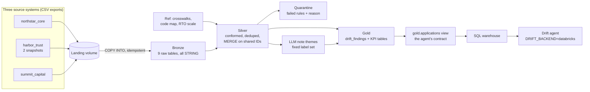

# Drift lakehouse on Databricks

The agent's data, rebuilt as a medallion pipeline on Databricks. The twist: the portfolio
arrives from **three simulated acquired companies**, each with its own IDs, column names,
codes and date formats, and silver has to put them on one shared definition before anything
can be compared. That is the core problem in post-acquisition data consolidation, at a size
that runs on Databricks Free Edition.



## What is in this folder

| Path | What it is | Status |
|---|---|---|
| `generate_sources.py` | Splits the v1 dataset (`seed/`) into the three source exports in `source_data/`, plus master data and a few deliberately dirty records | Done, tested |
| `source_data/` | The generated CSVs (committed) | Done |
| `pipeline/` | Shared config, table contracts, SQL runner (imported by notebooks and tests) | Done |
| `sql/gold.sql` | Gold tables, the agent-facing view, KPI tables | Done, tested on local Spark |
| `notebooks/00_setup` | Catalog, schemas, landing volume, master data, read-only grants | Done |
| `notebooks/01_bronze` | Lands the files, `COPY INTO` one bronze table per source and entity | Done |
| `notebooks/02_silver` | Conform, quarantine, dedupe, `MERGE` | **Scaffold: David writes this** |
| `notebooks/03_gold` | Runs `sql/gold.sql` | Done |
| `notebooks/04_note_themes` | LLM theme tagging of notes | **Scaffold: David writes this** |
| `notebooks/05_checks` | Contract, row accounting, keys, and the truth test against the SQLite demo | Done |

The agent side lives in `src/warehouse.py` (Databricks backend) and `src/sql_dialect.py`
(SQLite → Databricks SQL translation).

## The three sources

| | northstar_core | harbor_trust | summit_capital |
|---|---|---|---|
| Owns | Customer Platforms, Payments | Risk & Compliance, Treasury & Finance | Technology Resiliency, Internal Services |
| App IDs | `APP-0001` | `HT-58797` | `70412` |
| Drift IDs | `DR-2025-000001` | `HTD-143503` | `EVT-317915` |
| Dates | `2025-05-11` | `05/11/2025` | `20250511`, `2025-05-11T14:03:11Z` |
| Status | `Open` | `OPEN` | `is_open = true` |
| RTO | score 1-10 | hours | minutes |
| Data center | `Dallas` | `DAL` | `dallas-tx` |
| Product | `RHEL` | `Red Hat Enterprise Linux` | `rhel` |
| Quirks | one test app with RTO score 11 | sent drift twice (June 1 and June 27); two orphan drift rows | exemption request and decision in one field; 6 duplicate comments; one drift row with no detected version |

Every transformation is reversible, so a correct pipeline must reproduce the bundled SQLite
demo (`data/northstar_demo_rows.json`) exactly. `05_checks` tests that.

## Run it on Databricks Free Edition

**1. Add the repo as a Git folder.** Workspace → your home folder → **Create → Git folder**.
URL `https://github.com/David-P23/ai-drift-analytics-agent`, branch `databricks-migration`
(or `main` once merged). The repo is public, so no GitHub token is needed to clone it.

**2. Run `lakehouse/notebooks/00_setup`.** Attach serverless compute and Run all. It creates
the `drift_demo` catalog. If your workspace does not allow creating catalogs, set the
`catalog` widget to `workspace` and use that value in every notebook and in the job.

**3. Run `01_bronze`.** Expected rows:

| | applications | drift_instances | drift_notes |
|---|---|---|---|
| northstar_core | 401 | 222 | 395 |
| harbor_trust | 310 | 262 | 195 |
| summit_capital | 290 | 124 | 220 |

Run it a second time: `COPY INTO` loads 0 new rows.

**4. Write `02_silver`.** The notebook has the rules, a column mapping table, the plumbing,
and one worked example. Run `05_checks` as you go; it tells you what is still wrong.

**5. Run `03_gold`, then `05_checks`.** All checks green means gold reproduces the demo row
for row.

**6. Write `04_note_themes`** (after silver works).

**7. Schedule it.** Jobs & Pipelines → Create job. One notebook task per step, each depending
on the one before: `01_bronze` → `02_silver` → `03_gold` → `04_note_themes` → `05_checks`.
Source: the notebooks in your Git folder. Compute: serverless. Add a job parameter `catalog`
(`drift_demo`). Add a daily schedule if you want. `00_setup` only needs to run once (or with
`reset = true` for a clean rebuild). Free Edition allows 5 concurrent job tasks, so a
sequential chain fits.

## Point the agent at Databricks

1. **Warehouse details.** SQL Warehouses → your warehouse (Free Edition has one 2X-Small
   serverless warehouse) → **Connection details**: copy *Server hostname* and *HTTP path*.
2. **Token.** Settings → Developer → Access tokens → Generate new token, with an expiry date.
3. **Local `.env`** (gitignored, never commit it):

   ```text
   DRIFT_BACKEND=databricks
   DATABRICKS_SERVER_HOSTNAME=dbc-xxxxxxxx-xxxx.cloud.databricks.com
   DATABRICKS_HTTP_PATH=/sql/1.0/warehouses/xxxxxxxxxxxxxxxx
   DATABRICKS_TOKEN=dapi...
   DATABRICKS_CATALOG=drift_demo
   ```

4. `pip install -r requirements-databricks.txt` and `streamlit run app.py`. The header shows
   `Data source: Databricks drift_demo.gold: 475 findings`, and *SQL Evidence* shows the
   Databricks SQL that actually ran.

**Keep the public Render demo on SQLite.** Free Edition is for non-commercial use, has no SLA,
and shuts compute down for the day if you exceed the quota. A recruiter clicking a link that
depends on it could hit an error. Run Databricks mode locally and for demos.

**Read-only access.** The app's SQL validator blocks anything but a single `SELECT` on either
backend. On Databricks, pass `agent_principal` to `00_setup` to grant a user, group or service
principal `USE CATALOG`, `USE SCHEMA` and `SELECT` on `gold` only, and give it **Can use** on the
warehouse. With your own personal token the agent runs as you (a workspace admin), so the
validator is the guard; in a company you would use a service principal.

## What the tests prove, and what they don't

`pytest` (CI runs it on every push):

- `test_lakehouse_sources.py`: the source files regenerate byte for byte, map back to the v1
  dataset without loss, and every bronze row is accounted for.
- `test_lakehouse_spark.py` (local Spark 4, ANSI mode on): `gold.sql` built from correct silver
  matches the SQLite demo row for row; every agent query returns the same rows on SQLite and,
  translated, on Spark SQL; the executive summary and every suggested question give identical
  answers on both backends.
- `test_warehouse.py`: unsafe SQL never reaches the warehouse, the translation, type handling,
  and reconnect after a failure.

Not covered locally: `COPY INTO`, volumes, Unity Catalog grants and `MERGE` run only on
Databricks (Delta jars were not available offline). `05_checks` covers those on the platform.

## Design decisions worth explaining

- **Bronze is all STRING.** No parsing on the way in, so a bad date never drops a row before
  anyone sees it, and silver can be rebuilt from bronze at any time.
- **Master data is data, not code.** Crosswalks and code maps live in `ref` tables. Adding a
  fourth acquired company means adding rows to `ref`, plus one reader in silver.
- **Quarantine, don't drop.** Rows that fail a rule go to `silver.quarantine` as JSON with the
  reason, and `05_checks` proves bronze = silver + quarantined + superseded.
- **Latest extract wins.** Harbor's June 1 and June 27 snapshots overlap; silver keeps the newest
  per key before `MERGE` (MERGE refuses a batch with two rows for one key).
- **A view is the agent's contract.** `gold.applications` exposes exactly the 23 columns the
  agent was built on, so the agent's query templates did not change; `gold.drift_findings`
  can grow without breaking it.
- **The LLM classifies; SQL counts.** Theme tagging uses a fixed label list, runs once per
  distinct text, and is measured against hand labels before anyone reports a number from it.
